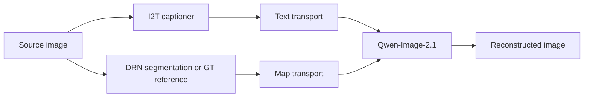

# StructText-SC

**Structure-aware textual supervision for generative semantic communication.**

StructText-SC studies **redrawability**: how well a textual description supports image regeneration that preserves scene content and structure. Reconstruction quality provides feedback for selecting textual supervision and adapting the transmitter-side image-to-text (I2T) encoder.

This repository brings together the original COCO-based supervised fine-tuning data and a Cityscapes workflow for joint text-and-segmentation-map reconstruction. **Qwen-Image-2.1** is the receiver-side image generator in the supplied workflow. The two datasets serve different purposes and are documented separately.

## Available in this release

| Resource | Status |
| --- | --- |
| Original SFT data: [`train_20260428.jsonl`](train_20260428.jsonl) | 1,234 records and 1,234 unique image references; original file preserved byte for byte |
| Dataset format, example and integrity checks | [Data documentation](docs/dataset.md), [example](data/example.json), [validator](scripts/validate_structtext_data.py) |
| Cityscapes preparation, captioning, transmission and reconstruction | Included; external models and dataset required |
| Source-image-only captioning | Default for Qwen/Gemma; an explicit map-assisted extension is also available |
| CPU tests | Included; GPU/model interfaces are partly mocked |
| SFT training recipe and fine-tuned checkpoints | Not included |
| SwinJSCC training and matching checkpoint | Not included; adapter and checkpoint validation are included |
| Paper evaluation split, metric evaluation and table/figure reproduction | Not included |

This is a data-and-workflow release. See [reproduction status](docs/reproduction.md) for the scope of the available implementation.

## Method and workflow

The supervision construction principle is a closed loop: generate candidate descriptions, assess their resulting reconstructions, retain suitable descriptions, and use them as textual supervision for transmitter adaptation. The full data-construction and fine-tuning pipelines are not part of this snapshot.

The implemented Cityscapes runtime follows this path:



- **Captioning:** BLIP, or Qwen3-VL/Gemma4 through SGLang. These are supported model families, not a statement that every checkpoint reproduces the paper. Qwen/Gemma receive only the source image by default. `source_and_map` is an optional extension.
- **Text transport:** Huffman coding, Reed–Solomon coding and packet loss.
- **Map transport:** a SwinJSCC adapter, a simplified pixel-AWGN mode, or a noise-free reference.
- **Reconstruction:** the receiver uses the received map and text. The source photograph is not supplied as a receiver reconstruction input.

Pixel-level AWGN is a demonstration mode. It does not implement SwinJSCC. Text packet-loss rates and map SNR values describe different channel mechanisms; matched communication budgets require an explicit accounting of both streams.

## Quick start

### 1. Install the CPU workflow dependencies

Use Python 3.10 or later. Linux is recommended for the GPU workflow and Bash entry points.

```bash
python -m venv .venv
source .venv/bin/activate
python -m pip install -r requirements.txt
```

The lightweight dependencies cover orchestration and CPU tests. Model execution requires a compatible PyTorch/CUDA environment and the selected external assets. See [installation and model assets](docs/installation.md).

### 2. Check the released SFT file

```bash
python scripts/validate_structtext_data.py
```

Expected: **1,234 records, 1,234 unique images**, with the SHA-256 recorded in [`data/provenance.json`](data/provenance.json). Images are obtained separately; paths in the JSONL are retained from the original release. See [dataset preparation](docs/dataset.md).

### 3. Configure and run the Cityscapes workflow

Follow the [complete workflow guide](docs/cityscapes-workflow.md) to prepare a **separate training-caption codebook corpus**, install model assets and set their paths. The workflow requires this corpus and its metadata in every channel mode, including `oracle`.

After configuring these assets, a two-sample BLIP / pixel-AWGN / Diffusers demonstration is:

```bash
# First edit configs/cityscapes.example.env and fill all required paths.
source configs/cityscapes.example.env
MASK_SOURCE=gt I2T_MODEL_FAMILY=blip \
CHANNEL_MODE=packet_awgn IMAGE_BACKEND=diffusers \
SPLIT=val LIMIT=2 GPU_DEVICES=0 IMAGE_WORKERS=1 \
bash work_flow_GenSemComv2.sh
```

This is a small execution example, not the paper's experimental configuration. Ground-truth maps are a reference setting. Use a new `RUN_DIR` for each run; existing directories are not overwritten.

For Qwen/Gemma captioning, set `I2T_CAPTION_INPUT_MODE=source_only` (the default). Prompt examples under [`prompt/`](prompt/) use this input contract. Changing the input mode or prompt requires regenerating captions and the corresponding training-caption codebook.

## Outputs and examples

Each run stores configuration snapshots, prompts, codebook hashes, manifests, captions, received data, reconstructed images and logs. An `artifacts/` index organizes the outputs. The [workflow guide](docs/cityscapes-workflow.md) describes the directory layout.

An [archived qualitative illustration](docs/qualitative.md) is supplied separately from the runnable example. Its original labels are preserved; it is not a rerun of the updated source-only captioning configuration.

## Tests

```bash
python -m unittest discover -s tests -v
```

The tests exercise data handling, caption requests, channel logic and reconstruction interfaces. They do not run a GPU end-to-end paper experiment. See [validation notes](docs/validation.md).

## Repository layout

```text
train_20260428.jsonl             Original COCO-based SFT data
data/                          Example, provenance and measured statistics
configs/                       Editable workflow configuration example
prompt/                        Source-image-only caption prompt variants
scripts/                       Preparation, captioning, channels and generation
tests/                         CPU and mocked-interface tests
docs/                          Data, installation, workflow and release scope
assets/                        Archived qualitative illustration
work_flow_GenSemComv2.sh        Cityscapes workflow entry point
```

## License and attribution

The supplied workflow code retains its [MIT license](LICENSE). The legacy SFT data, source images, Cityscapes-derived illustration, external models and third-party software have their own provenance and terms; the code license does not relicense those resources. See [resource notices](THIRD_PARTY_NOTICES.md).

Repository: [wsyCUHK/StructText-SC](https://github.com/wsyCUHK/StructText-SC). Changes in this snapshot are listed in [CHANGELOG.md](CHANGELOG.md).
